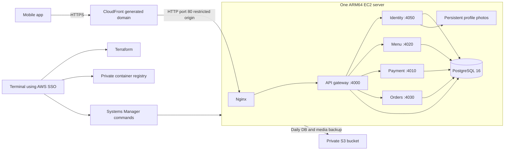

# AWS staging deployment with Terraform

This is a reviewable deployment plan for the FoodMenu MVP. Preparing or running `terraform plan` does not deploy the application. The `apply`, ECR upload, SSM and migration commands below change AWS resources when an operator runs them. No AWS application resources have been provisioned as part of preparing this plan.

## Plan and estimated idle cost

Region: **London (`eu-west-2`)**. Account: `844706634415`. Environment: `staging`.



**Budget about $37–40 USD/month while idle**, before tax, credits, account-specific discounts and external provider fees. $10 remains an alert threshold; it does not cap spending or stop resources. No traffic does not stop EC2, EBS or IPv4 billing.

Estimate checked on 9 November 2026; 730 running hours/month:

| Component | Assumption | Monthly USD |
| --- | --- | ---: |
| EC2 Linux `t4g.medium` | 2 vCPU, 4 GiB, $0.0376/hour | $27.45 |
| Encrypted gp3 disk | 60 GiB at $0.0928/GiB-month; included baseline IOPS/throughput | $5.57 |
| One Elastic IPv4 address | $0.005/hour | $3.65 |
| Parameter Store | One Advanced SecureString, plus small request allowance | ~$0.05–0.10 |
| ECR, S3 backups/state and requests | Allowance for a few GiB of images and modest backup sizes | ~$0.50–2.00 |
| CloudFront | Pay-as-you-go; near-zero traffic at idle | ~$0 at idle |
| **Estimated total** | | **~$37–40** |

EC2/EBS rates were read from the AWS Price List API for `EU (London)`: EC2 SKU `NS7JYC3H64QFC93K`; gp3 storage SKU `MJ9PYUE89BCM5XDZ`. Check prices again before applying. Supporting public pricing: [EC2](https://aws.amazon.com/ec2/pricing/on-demand/), [EBS](https://aws.amazon.com/ebs/pricing/), [IPv4](https://aws.amazon.com/vpc/pricing/), [Parameter Store](https://aws.amazon.com/systems-manager/pricing/), [ECR](https://aws.amazon.com/ecr/pricing/), [S3](https://aws.amazon.com/s3/pricing/), [CloudFront](https://aws.amazon.com/cloudfront/pricing/).

The estimate excludes build/deploy transfer, growing data/backups, application requests, Gemini, SMTP, Google Routes, Stripe, Stuart, paid support and optional AWS security/scanning subscriptions. Runtime container logs rotate on the server; CloudWatch log ingestion is not enabled. CPU credits use **standard** mode to avoid surplus-credit charges; sustained CPU usage can be throttled. The 4 GiB size is a starting point, not a measured capacity guarantee.

No RDS, ALB, NAT gateway, Route 53 zone or custom-domain certificate is created. This avoids their additional recurring charges. A smaller 2 GiB machine might run out of memory with five Node services and PostgreSQL; downsize only after measuring.

## Security and availability boundaries

- Public URL is `https://<distribution>.cloudfront.net`; no custom domain is needed. CloudFront caching is disabled for all routes, including account endpoints, and viewer credentials/query strings are forwarded. SSE response buffering and compression are disabled at nginx/CloudFront.
- **Origin transport limitation:** viewer-to-CloudFront is HTTPS, but CloudFront-to-EC2 is HTTP. The EC2 security group accepts port 80 only from the AWS CloudFront origin prefix list; nginx additionally requires a random origin header. This restriction does not encrypt the origin connection. Review this tradeoff before using real customer data; a custom origin domain/certificate or a different TLS-capable ingress design is needed for end-to-end HTTPS.
- SSH, PostgreSQL and microservice ports have no public ingress. The gateway binds to the host's loopback interface; management uses SSM. IMDSv2 is required and its hop limit prevents ordinary container access to the instance role.
- The instance role uses the existing PowerUserAccess **permissions boundary**, with a separate small inline policy limited to SSM, this runtime parameter, ECR pulls and this artifact bucket. The boundary is a ceiling, not the permissions grant.
- `TRUST_PROXY_HOPS=2` is specific to CloudFront → nginx → gateway. nginx appends the CloudFront source address; the gateway then reads the correct client address for rate limiting. Leave this setting `0` for direct/local exposure. nginx strips the private origin header before forwarding requests.
- PostgreSQL and photos live on persistent encrypted EC2 storage. Instance replacement/destruction is blocked by Terraform `prevent_destroy`; the root volume also remains after termination. These protections do not replace backups or prevent deletion outside Terraform.
- This is **one server, one availability zone, and one database**. A reboot, failed release, full disk or host failure can interrupt the entire app. No automatic failover, database point-in-time recovery or zero-downtime deployment is included. Backups run daily at 02:17 UTC; potential data loss is up to the last successful backup. Monitor backup success and disk use through SSM, and perform a restore rehearsal before client testing.
- Secrets are copied from the operator's local `.env` into one SSM Advanced SecureString. They are never Terraform inputs or Terraform-managed parameter values. `.cloud/` holds private temporary deployment files and is ignored by Git/Docker. Terraform state contains the origin header token and must remain private.

## Files

- `infra/terraform/state`: private, encrypted, versioned S3 state bucket bootstrap.
- `infra/terraform/staging`: networking, fixed IP, server, instance role, private ECR/S3 and CloudFront.
- `infra/bootstrap/foodmenu-terraform-iam.json`: the additional IAM permissions already discussed in [AWS access setup](aws-access-setup.md).
- `infra/deploy`: server bootstrap, Compose, nginx, remote deployment and backup scripts.
- `scripts/cloud/manage.cjs`: terminal commands to prepare, migrate, deploy and back up. It never runs Terraform apply.

## 1. Prerequisites and non-billable preview

Use AWS CLI v2 (plus the Session Manager plugin for interactive shells), Terraform >=1.10, Node.js with this repository's dependencies, and Docker Desktop with a working Linux ARM64 builder. The server uses Ubuntu 22.04 ARM64 and images are built with `--platform linux/arm64`. Do not use x86 images with this plan.

```bash
export AWS_PROFILE=foodmenu-deploy-PowerUserAccess-844706634415
aws sso login --profile "$AWS_PROFILE"
aws sts get-caller-identity --profile "$AWS_PROFILE"
npm ci
terraform -chdir=infra/terraform/state init
terraform -chdir=infra/terraform/state validate
terraform -chdir=infra/terraform/state plan -out=state.tfplan
terraform -chdir=infra/terraform/staging init
terraform -chdir=infra/terraform/staging validate
terraform -chdir=infra/terraform/staging plan -out=staging.tfplan
```

Review the account, region, AMI and every resource. The initial preview has **4 state-bucket resources and 20 staging resources**, no updates/deletions. Runtime SSM secrets are uploaded later by the deployment helper, outside Terraform. Costs start with `apply`, not with `plan`.

Terraform defaults contain the current account/profile. For another target, copy `terraform.tfvars.example` to `terraform.tfvars` and update it deliberately. Do not put secrets in tfvars. Commit provider `.terraform.lock.hcl` files; do not commit state, plan binaries or `.cloud` files.

## 2. Provision after reviewing the cost and plan

These commands create chargeable infrastructure. Run this section only when ready to incur the estimate above.

First create the small state bucket:

```bash
terraform -chdir=infra/terraform/state apply state.tfplan
```

The bootstrap module initially keeps its own small state locally. Back up its `terraform.tfstate` securely; it manages the state bucket itself. Configure remote state for the application **before applying the staging infrastructure**:

```bash
cp infra/terraform/staging/backend.tf.example infra/terraform/staging/backend.tf
terraform -chdir=infra/terraform/staging init -migrate-state \
  -backend-config='bucket=foodmenu-tfstate-844706634415-eu-west-2' \
  -backend-config='key=staging/terraform.tfstate' \
  -backend-config='region=eu-west-2' \
  -backend-config="profile=$AWS_PROFILE" \
  -backend-config='encrypt=true' \
  -backend-config='use_lockfile=true'
terraform -chdir=infra/terraform/staging plan -out=staging.tfplan
terraform -chdir=infra/terraform/staging apply staging.tfplan
terraform -chdir=infra/terraform/staging output api_url
```

Pin the selected `ami_id` from the approved plan into your local staging tfvars before future infrastructure changes. Otherwise a newer Ubuntu AMI can propose instance replacement, which `prevent_destroy` deliberately blocks. Do not bypass that protection to update an existing database host.

CloudFront/SSM/bootstrap can take several minutes to become ready. The helper waits for the bootstrap marker; if it fails, inspect cloud-init/SSM status rather than repeatedly applying. Do not print `terraform output -json` to shared logs: it includes the sensitive origin token.

## 3. Prepare the server and copy the existing local data

Confirm that the local `.env` points at the **local source database**. Preserve `EMAIL_VERIFICATION_SECRET` so existing verification challenges can still be checked. The helper creates a fresh cloud DB password once, keeps it in `.cloud/staging.env`, and preserves it on future deployments. Never delete this file and generate another password for an existing PostgreSQL volume; recover the parameter privately from SSM if the file is lost.

Review the SMTP, Google, Stripe, Stuart and Gemini settings in the source `.env`. For an MVP keep payment/delivery credentials in sandbox/test mode. SMTP sandbox messages remain in Mailtrap rather than reaching real inboxes. `FOODMENU_APP_URL` must be the actual web frontend origin when using a web build; native mobile clients do not have the same browser CORS restriction.

```bash
node scripts/cloud/manage.cjs prepare
```

This builds/pushes runtime and migration-tool images, uploads the cloud environment as a SecureString, installs Compose/nginx, pulls images and starts **only PostgreSQL**. The API is not started on an empty seeded database.

Stop local app writes, payments/webhook activity and photo uploads for the migration window. Keep the local database running. Then:

```bash
node scripts/cloud/manage.cjs migrate
```

The migration helper:

1. Dumps the existing database using a PostgreSQL 16 Docker client. Local `localhost` is mapped to `host.docker.internal`; credentials are passed as process environment, not command-line values. A newer source PostgreSQL major version requires updating both client and cloud database versions first; the dump should fail rather than produce an incompatible restore.
2. Archives `public/assets` and `PROFILE_PHOTO_STORAGE_DIR` (default `uploads/profile-photos`). Both are required because image files are not contained in SQL backups.
3. Uploads the private dump/media into the deployment's expiring S3 prefix.
4. **Refuses to restore if the target public schema contains tables.** Restores using a single transaction and no owner/ACL imports. Existing `_prisma_migrations` history is preserved.
5. Runs only pending Prisma migrations with `prisma migrate deploy`. **No seeds or resets run.** Existing customers, menus, configuration, orders, sessions and conversation state stay in the copied database.
6. Starts all five services and registers daily backups. Gateway health is checked before reporting success.

A SQL dump is consistent at one snapshot; SQL and photo files are not one atomic snapshot. Freezing local writes/uploads during the copy avoids mismatch. A failed dump/restore must be investigated before retrying; a completed restore followed by a later migration/health failure will cause a repeated `migrate` to refuse the nonempty target. Use `deploy` after correcting the failure, rather than deleting the database.

The helper changes the **cloud runtime** `PUBLIC_ASSET_BASE_URL` to the CloudFront URL and mounts copied images. Existing menu `/assets` URLs and managed profile photos are resolved by the backend. Arbitrary absolute URLs embedded in old order snapshots or conversation cards are not globally rewritten by this deployment. Check representative historical responses; if they still contain local URLs, perform a reviewed, scoped data repair before sharing the mobile build. Avoid replacing external restaurant/Google image URLs indiscriminately.

Private local migration artifacts remain in `.cloud` for recovery; securely remove them after verifying the cloud copy. Deployment S3 objects expire after 7 days; daily backup objects after 14 days, with noncurrent versions retained for a further 7 days. S3 expiry is asynchronous and delete markers can remain. Large photo libraries or databases increase storage cost.

## 4. Connect the mobile app and providers

Read `terraform output api_url` and configure the mobile API origin to that HTTPS URL, keeping its existing `/api/v1` suffix convention. This requires a separate frontend environment/build update.

Verify before enabling real customer traffic:

- `GET /api/v1/health`, `/api/v1/app/config`, `/api/v1/ai/config`, menu image URLs and Swagger `/api/docs`.
- A migrated account login, profile/photo, addresses, orders and saved AI conversation history.
- A new signup, Mailtrap code verification, Google sign-in, recommendation stream and a test checkout/payment.
- Configure Stripe's endpoint to `https://<distribution>.cloudfront.net/api/v1/webhooks/stripe`, select the application's handled events and update the signing secret in the local environment before deploying again. Configure the Stuart callback and matching secret similarly using its implemented webhook route. Neither provider configuration is changed automatically.
- Do not expect browser CORS, Google OAuth client configuration, phone build configuration or provider callbacks to update themselves when AWS infrastructure is created.

The health endpoint confirms the gateway is up; it does not prove every database/provider workflow works. Exercise the flows above.

## 5. Later releases, backups and diagnostics

```bash
# Optional explicit backup; deploy also takes one before updating.
node scripts/cloud/manage.cjs backup

# Build/push a new release, back up, apply pending migrations, copy new/changed
# public/assets files (e.g. category icons) to the server and restart services.
node scripts/cloud/manage.cjs deploy

# After a deploy that changed prisma/seed-data: back up, then run the additive,
# idempotent catalogue seed (upserts seeded records by id; never deletes), and
# publish prisma/ai-concierge-config.json as the active AI configuration (versioned
# by content hash; older versions stay in AiConfiguration).
node scripts/cloud/manage.cjs seed

aws ssm start-session --target <instance-id> --profile "$AWS_PROFILE" --region eu-west-2
```

Within the SSM shell:

```bash
sudo -i
cd /srv/foodmenu
docker compose --env-file .env --env-file .release.env logs --tail=100 api-gateway
systemctl status foodmenu.service nginx
cat /var/log/foodmenu-backup.log
df -h
```

Runtime and migration errors may include customer data: inspect SSM output/logs privately. The terminal helper avoids printing captured subprocess errors or environment contents. No automatic log shipping or alerting for a failed daily backup is included; check its S3 timestamp after the first scheduled run.

For recovery, provision a reviewed replacement host or an isolated restore target, fetch a successful backup's dump/media pair and restore them to an empty PostgreSQL 16 database using the same `pg_restore --single-transaction --exit-on-error --no-owner --no-acl` process. Reapply pending migrations, restore photos, and verify data before switching traffic. Do not restore a backup over a running database. ECR keeps three runtime/tool releases; deployment performs a restart, so expect a short outage. An older image may not be compatible with a newer schema; image rollback is not a database rollback.

Stopping EC2 pauses compute charges but keeps disk, Elastic IP and stored backups/images billable; the API is unavailable while stopped. `terraform destroy` is intentionally blocked for the database host, ECR and buckets. Teardown requires an explicit backup/data-retention decision and deliberate removal of the protection; retained volumes/IPs/buckets can continue billing.

## Validation

Completed during plan preparation:

- Terraform formatting and validation passed for both modules. Live read-only previews: 4 state-bucket creates and 20 staging creates; no updates/deletions.
- Reviewed the saved plan for CloudFront-only ingress, required IAM boundary, encrypted disk, IMDSv2 and standard CPU credits.
- All five NestJS services built successfully; both local ARM64 runtime/tools Docker images built.
- All 140 backend unit tests and 5 environment-helper tests passed.
- Disposable Compose smoke passed: all migrations, six running containers, gateway health, menu RPC, authentication rejection, assets, literal SMTP credential handling and the commerce event table. The temporary stack was removed.
- Shell syntax, Compose configuration and Git whitespace checks passed.

Cloud provisioning, SSM on an actual EC2 host, nginx/CloudFront integration, live database import, off-host restore rehearsal and provider workflows remain deployment-time checks. No AWS application resources or cloud data imports were created by these checks.

To repeat checks, use `node --test scripts/cloud/environment.test.cjs`, `bash -n infra/deploy/*.sh`, Terraform format/validate/plan, Docker Compose configuration validation and local image builds. Build `foodmenu:terraform-review` with `docker build --target runner -t foodmenu:terraform-review .` and `foodmenu:terraform-tools-review` with `docker build --target tools -t foodmenu:terraform-tools-review .`, then run `node scripts/cloud/smoke.cjs` for the isolated local stack check. The preparation work does not run cloud provisioning, data import or live provider payment tests. See the implementation report for the checks actually completed.

## Preparation errors and AWS console locations

`migrate` requires a successful `prepare`. If `.cloud/deployment.json` is missing, fix preparation and rerun it; do not create that metadata manually. The helper now names the failed Docker step and writes captured diagnostic output into owner-only `.cloud/errors/*.log` files. Inspect those files privately: they can contain provider errors or secrets. They are excluded from Git and Docker uploads.

The Docker ECR login uses a piped stdin for its password. A regression test covers this because ignoring stdin caused the earlier login failure. `docker info` must work, Docker Desktop must be running, and SSO credentials must be current. Retry `node scripts/cloud/manage.cjs prepare`, and only after it completes run `node scripts/cloud/manage.cjs migrate`.

Select **Asia Pacific (Mumbai), ap-south-1** in the AWS console to inspect the current deployment:

- **EC2 → Instances:** the `foodmenu-staging` server. A running instance does not mean the application has been prepared or started.
- **ECR → Private repositories → foodmenu-staging:** runtime/tool images appear after successful builds and pushes.
- **Systems Manager → Fleet Manager / managed nodes:** confirm the instance is online. **Run Command → Command history:** inspect preparation/migration commands after the helper submits them. Local Docker failures have no SSM command record.
- **Systems Manager → Parameter Store:** `/foodmenu/staging/runtime-env` appears after the environment upload. Its value is secret.
- **S3:** the `foodmenu-staging-artifacts-844706634415-ap-south-1` bucket holds deployment files and backups.
- **CloudFront:** global service; use `terraform output api_url`. A distribution can exist before its backend application is available.

The earlier London budget and SSO configuration remain separate from the Mumbai application. The original cost table is the London baseline; obtain a new Mumbai estimate before treating it as the current region's quote.

If EC2 is running but SSM reports no managed node, bootstrap output alone does not establish agent readiness. The initial role omitted parts of AWS's core SSM agent permissions. The Terraform role now includes the core document/association/inventory and legacy message-channel actions, while parameter reads remain restricted to this application's parameter. This follows [AmazonSSMManagedInstanceCore](https://docs.aws.amazon.com/aws-managed-policy/latest/reference/AmazonSSMManagedInstanceCore.html) without granting reads of every application secret. Review and apply the role update, then confirm the instance is online before preparation. If it remains absent, investigate SSM agent logs/network access rather than treating the policy change as proof of registration.

`InvalidInstanceId` from `SendCommand` can mean EC2 is running but SSM has not registered it or the agent has not connected yet. After IAM changes, allow registration/permission propagation and confirm **Online** in Systems Manager. The CLI now checks this before building/pushing images, waits up to approximately five minutes, and reports the specific AWS operation on failure. An online EC2 status check alone does not establish SSM readiness.
